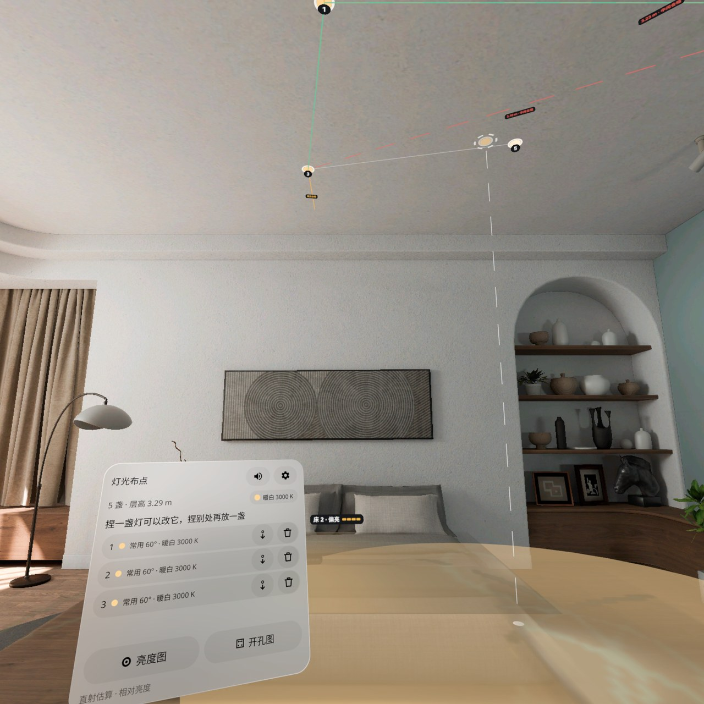
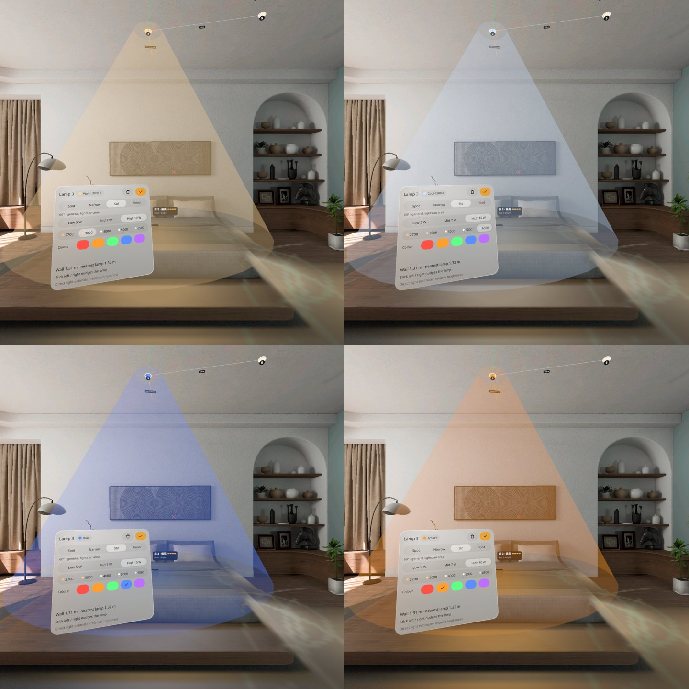
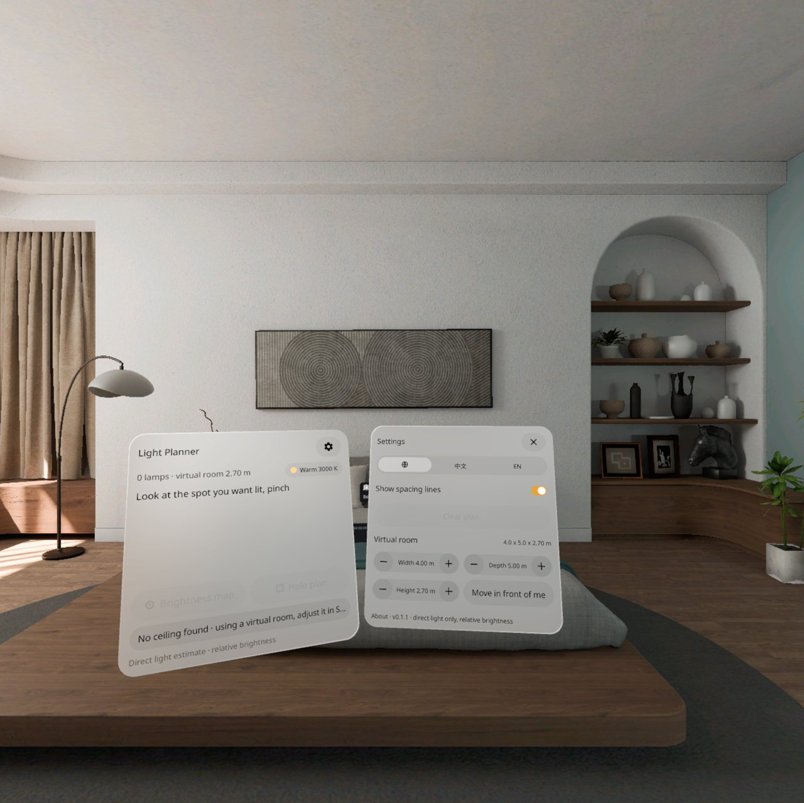
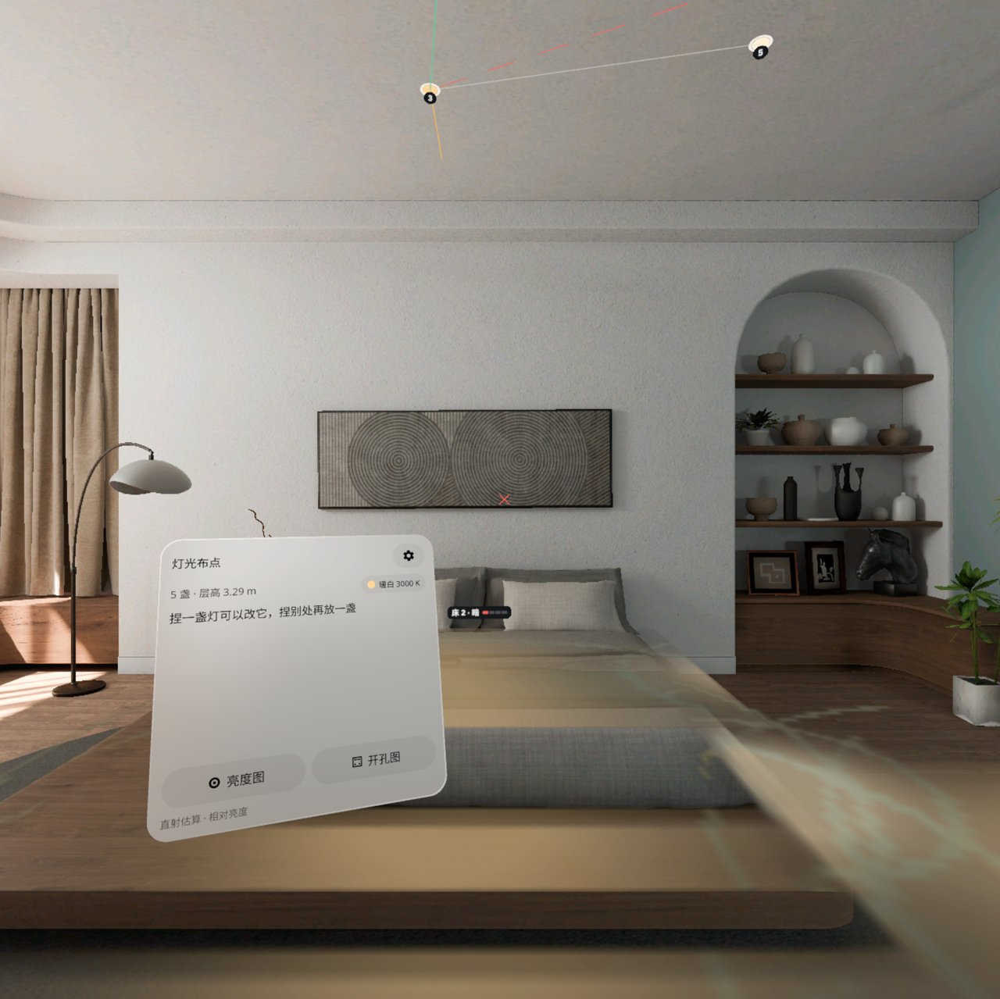

<p align="center"></p>

# Light Planner | 灯光布点

**看向你想照亮的地方捏一下，筒灯就装在正上方的真天花板上，光斑落在你家桌面和沙发上，间距对不对一眼就知道。**

**Look at the spot you want lit and pinch: a downlight lands on the real ceiling right above it, its light pool falls on your real desk and sofa, and you can see at a glance whether the spacing is right.**

PICO OS 6 · PICO Spatial SDK 6.1.9 · Kotlin / SpatialUI · package `io.embodit.lightplanner` · v0.1.2

> **v0.1.2 按头显试用反馈：手柄射线放灯（天花板上先出幽灵筒灯和光斑预览，扣扳机装上，按住可拖）、主面板静音键、灯列表。用户已在头显上看过 v0.1.2。**
> **v0.1.2 from headset feedback: place lamps with the controller ray (a ghost downlight and pool preview, trigger to place, hold to drag), a mute key on the main panel, and a lamp list. Checked by the user on the headset.**




> 截图和演示视频来自原生模拟器（PICO Emulator 6.1），由调试广播和模拟器鼠标（= 视线 + 捏合）驱动；部分截图把界面切到中文（设置 · 中文），部分是模拟器默认英文；**非真实手势录像**。
> Screenshots and the demo video were taken on the native PICO emulator, driven by debug broadcasts and the emulator mouse (standing in for gaze + pinch); some screenshots switch the UI to Chinese, others show the emulator default English; **not a recording of real hand gestures.**

---

## 中文

### 这是什么

装修前布筒灯：看着想照亮的桌面、沙发、床或地面捏一下，一盏筒灯就装到正上方的真天花板上，光斑落在下面的真家具和地面上。灯与灯之间在天花板上画间距线：间距合适是绿线，太远会标红「中间会暗」；离墙太近画一条琥珀短线。每张桌子、茶几、沙发、床上方有一个小标签（中文名在前，例如「茶几 · 偏暗」，界面是英文时下面一行小字英文）：暗 / 偏暗 / 合适 / 偏亮 / 不均，标签始终转向你、不会镜像或倒置。

捏灯选中，可以改光束角（聚光 24° / 窄光 36° / 常用 60° / 泛光 90°）、亮度（约 5 / 7 / 10 W）、光色（色温 2700 / 3000 / 4000 / 5000 / 6500 K，或红 / 琥珀 / 绿 / 蓝 / 紫 5 种彩光，光斑和光锥跟着变色，面板上的色卡一眼看出当前光色），捏住拖动挪位置，挪的时候会和别的灯对成一排。打开「亮度图」，地面和家具换成由暗到亮的伪彩；打开「开孔图」，出一张俯视平面图和表格（光束、功率、色温、离墙距离），给电工开孔用。最多 16 盏，方案自动保存、下次打开放回原位。面板在你正前方偏左、视线下 15° 左右，看天花板放灯时不用抬头找面板；转个身它会跟到新的正前方。扫不到天花板时 5 秒后直接用一间虚拟房间（默认 4 × 5 × 2.7 m，设置里调宽、长、高，或「移到我面前」），之后扫到真天花板会自动换回。中英双语，全部本机保存，不联网。

只算直射光，显示相对亮度，不是照度计。

### 安装与启动

```bash
adb install -r LightPlanner-v0.1.2.apk
pico-cli app launch io.embodit.lightplanner
```

从 v0.1.0 升级：v0.1.0 和 v0.1.1 的调试签名不同，`install -r` 会报 `INSTALL_FAILED_UPDATE_INCOMPATIBLE`，要先 `adb uninstall io.embodit.lightplanner` 再装（会清掉头显上保存的方案）。

APK 在 [Releases](https://github.com/kejing-dev/LightPlanner/releases) 页面下载（仓库不含 APK）。需要 PICO OS 6 头显或 PICO Emulator 6.1；用到天花板 / 家具平面识别和空间锚点。APK 约 34 MB。覆盖安装前先 `adb shell am force-stop io.embodit.lightplanner`：在应用运行时直接覆盖安装，模拟器上会留下一个关不掉的「没有响应」框。

### 容器与骨架

- **容器**：只有 Full Space · `STAGE_MIXED`（透视），没有 Shared Space 版本。灯要装在真天花板上、光斑要落在真家具上，依赖天花板 / 家具平面识别和世界锚点，只在 Full Space 可用。
- **骨架 D**（同影院规划 Theater Planner / 空间尺 Spatial Ruler）：面板池、Stage 根实体、平面碰撞体、世界锚点、系统拖动换算、懒跟随、摇杆输入。光照在后台线程按 cosⁿ 光强模型和直射遮挡估算，结果画成动态贴图光层；网格和贴图排队按帧生成。
- **状态**：设计包 18 个状态（S00–S17），全部可由调试广播直接跳转并截图，结构见 [AGENTS.md](AGENTS.md)。

### 截图

| | |
|---|---|
|  |  |
| 说明页 — 抬头 · 捏一下 · 坐过去看 | 布灯 — 5 盏灯，绿线合适、红线中间会暗 |
|  |  |
| 聚光 24° — 光锥变窄，光斑落在光锥脚下 | 单灯面板 — 光束 / 亮度 / 色温 5 档 / 彩光 5 种，标题旁色卡 |
|  |  |
| 光色 — 暖白 / 冷白 6500 K / 蓝 / 琥珀，光锥和光斑跟着变 | 虚拟房间 — 扫不到天花板 5 秒后自动用，设置里调尺寸 |
|  | |
| 标签 — 「床 2 · 偏亮」正向可读，面板在视线下方不挡 | |
|  |  |
| 亮度图 — 暗 · 偏暗 · 合适 · 偏亮 | 开孔图 — 平面图 + 表，给电工开孔 |

启动器图标：


### v0.1.2 改了什么

- **手柄射线放灯**：预览跟着手柄射线走——射线指到哪儿，天花板上就出现一盏半透明的「幽灵」筒灯，下面带一圈下一盏灯的光斑；扣扳机就装在幽灵的位置。放好后指着灯按住扳机能拖，灯跟着射线走。没手柄时用视线。
- **主面板静音键**：标题行右侧喇叭键，一眼可见，状态记住；连续乱点时同一种提示音限频，不会连响。
- **灯列表**：主面板列出所有灯（编号、光束、光色），点一行选中，箭头键把这盏灯移到你正前方 1.5 m 的天花板上，垃圾桶删除（可撤销）。

### v0.1.1 改了什么

- **3D 文字倒置**：引擎取贴图时 v=0 是位图最底一行，0.1.0 把它给了标签上沿，所有家具标签、灯号、间距字上下颠倒。改了取样方向，加单元测试保证只绕竖直轴转、朝向你、不镜像。
- **光斑沿深度方向镜像**（同一根因，排查时发现）：灯不在平面正中时，0.1.0 的光斑会落到对面。已改，模拟器上 24° 聚光的光斑落在光锥脚下。
- **面板要抬头看**：0.1.0 看天花板时面板跟着视线上抬。现在面板固定在水平线下约 15°、0.85 m、正前方偏左 20°，按当前头的位置和朝向摆；转身后跟到新的正前方。设置和开孔图在主面板右侧、上沿对齐往下长。
- **光色可选**：色温 5 档 + 彩光 5 种；光斑、光锥、灯圈都跟着变色；面板色卡一眼可见。
- **扫不到天花板不再卡住**：5 秒后进虚拟房间（原来要等 20 秒再手动选层高）。
- UI 遮挡全量排查清单见工厂 `apps/light-planner/build/ui-audit.md`。

### 已知问题（QA 第 1 轮，不影响使用）

- 开孔图的平面图上，灯靠得近时距离数字叠在一起看不清；下面表格里同样的数字是清楚的，照表格量即可。
- 选中一盏灯时打开开孔图，偶尔第一帧是空白卡片，几秒后正常画出。
- 仅调试路径：没点过「开始」就用调试指令放的灯，重开后会丢、编号接着往下排；正常使用一定先点「开始」，碰不到。

v0.1.1 头显上还要再看：标签和灯号是正的、看天花板时不用抬头、转身后面板跟到正前方、换光色光斑跟着变。

还没在头显上验过（v0.1.0 起）：真手柄摇杆微调的手感、光斑贴在真桌面 / 沙发上准不准、筒灯装在真天花板上的位置、坐过去看的亮度感觉、真实权限流程、退出重开后锚点能不能在真房间找回。

---

## English

### What it is

Plan downlights before renovating: look at the desk, sofa, bed or floor you want lit and pinch, and a downlight is mounted on the real ceiling right above it, with its light pool falling on the real furniture and floor below. Lines between lamps on the ceiling show the spacing: green when fine, red with a warning when the gap would leave a dark patch, plus a short amber line when a lamp is too close to a wall. Every desk, coffee table, sofa and bed gets a small tag (dark / dim / good / bright / uneven), Chinese name first with an English line under it when the UI is in English; tags always turn to face you and are never mirrored or upside down.

Pinch a lamp to select it and change the beam (Spot 24° / Narrow 36° / Std 60° / Flood 90°), output (about 5 / 7 / 10 W) and light colour (2700 / 3000 / 4000 / 5000 / 6500 K, or red / amber / green / blue / violet; the pool and cone take the colour, and a chip on the panel shows it at a glance); pinch and drag to move it, and it snaps into a row with the other lamps. The brightness map recolours floor and furniture from dark to bright; the hole plan shows a top-down plan and a table (beam, power, colour, distance to walls) for the electrician. Up to 16 lamps; the plan is saved and put back next time. The panel sits ahead and a little to the left, about 15° below eye level, so you never look up to find it while placing lamps on the ceiling; turn round and it follows to your new front. If no ceiling is found within 5 s, a virtual room takes over (4 × 5 × 2.7 m by default; width, depth, height and "move in front of me" in Settings) and a real ceiling found later replaces it. Chinese and English; everything stored on the device, no network.

Direct light only, relative brightness — this is not a light meter.

### Install and launch

```bash
adb install -r LightPlanner-v0.1.2.apk
pico-cli app launch io.embodit.lightplanner
```

Upgrading from v0.1.0: the two builds have different debug signatures, so `install -r` fails with `INSTALL_FAILED_UPDATE_INCOMPATIBLE`; `adb uninstall io.embodit.lightplanner` first (this removes the plan saved on the headset).

Download the APK from the [Releases](https://github.com/kejing-dev/LightPlanner/releases) page (the repository itself does not ship an APK). Needs a PICO OS 6 headset or PICO Emulator 6.1; uses ceiling / furniture plane detection and spatial anchors. The APK is about 34 MB. Run `adb shell am force-stop io.embodit.lightplanner` before reinstalling: replacing the app while it runs leaves a "not responding" dialog on the emulator that cannot be dismissed.

### Container and skeleton

- **Container**: Full Space only, `STAGE_MIXED` (passthrough); no Shared Space version. Lamps mount on the real ceiling and pools land on real furniture, which needs ceiling / furniture plane detection and world anchors — Full Space only.
- **Skeleton D** (same as Theater Planner / Spatial Ruler): panel pool, Stage root, plane colliders, world anchors, system-drag conversion, lazy follow, thumbstick input. Lighting is estimated on a background thread with a cosⁿ intensity model and direct-light occlusion, drawn as a dynamic texture layer; meshes and textures are queued across frames.
- **States**: 18 designed states (S00–S17), each reachable by a debug broadcast and captured; see [AGENTS.md](AGENTS.md).

### Screenshots

See the table above: intro, five-lamp layout, 24° spot, lamp panel, light colours, virtual room, furniture tags, brightness map, hole plan.

### What changed in v0.1.2

- **Placing with the controller ray**: the preview follows the controller ray. A see-through "ghost" downlight appears on the ceiling above where the ray points, with a faint pool of the next lamp below; pull the trigger and the lamp goes exactly there. Point at a placed lamp and hold the trigger to drag it along the ray. Without a controller the gaze is used.
- **Mute key on the main panel**: a speaker key in the title row, remembered; repeated pinches no longer fire the same sound back to back.
- **Lamp list**: the main panel lists every lamp (number, beam, colour); tap a row to select it, the arrow key brings that lamp onto the ceiling 1.5 m in front of you, the bin deletes it (with undo).

### What changed in v0.1.1

- **Upside-down 3D text**: the engine samples a texture with v = 0 at the bitmap's bottom row; 0.1.0 gave that to the top of the label quad, so every furniture tag, lamp number and spacing label was upside down. Fixed, with unit tests that labels turn about the vertical only, face you and are not mirrored.
- **Pools mirrored along depth** (same root cause, found while checking): with a lamp off the middle of a surface, the 0.1.0 pool landed on the opposite side. Fixed; on the emulator the 24° pool sits at the foot of its cone.
- **Looking up at the panel**: 0.1.0 raised the panel with the gaze when you looked at the ceiling. It now rests 0.85 m away, about 15° below the horizon, 20° left of ahead, from the current head position and yaw; settings and the hole plan sit to its right, top-aligned, growing downwards.
- **Light colour**: five colour temperatures plus five colours; pool, cone and lamp ring follow; a chip on the panel shows the colour.
- **Never stuck on scanning**: a virtual room after 5 s (0.1.0 waited 20 s, then asked for a height).

### Known issues (QA round 1, none blocking)

- On the hole plan's drawing, distance numbers overlap when lamps are close; the same numbers in the table below are clear.
- Opening the hole plan with a lamp selected occasionally shows a blank card for the first frame; it draws a few seconds later.
- Debug path only: lamps placed by debug command before tapping Start are lost on reopen and numbering continues; normal use always starts with Start.

Still to check on the headset for v0.1.1: upright labels and lamp numbers, no looking up for the panel while placing on the ceiling, the panel following after turning round, pools changing colour.

Not yet verified on a headset (since v0.1.0): thumbstick fine-tuning with a real controller, how accurately pools sit on a real desk / sofa, lamp position on a real ceiling, how the brightness feels when sitting down, the real permission flow, and restoring anchors in a real room after reopening.

---

## License

Source code © 2026 Embodit. All rights reserved (private repository). Bundled fonts Noto Sans / Noto Sans SC (subset) are under the SIL Open Font License, see `third_party/`.
