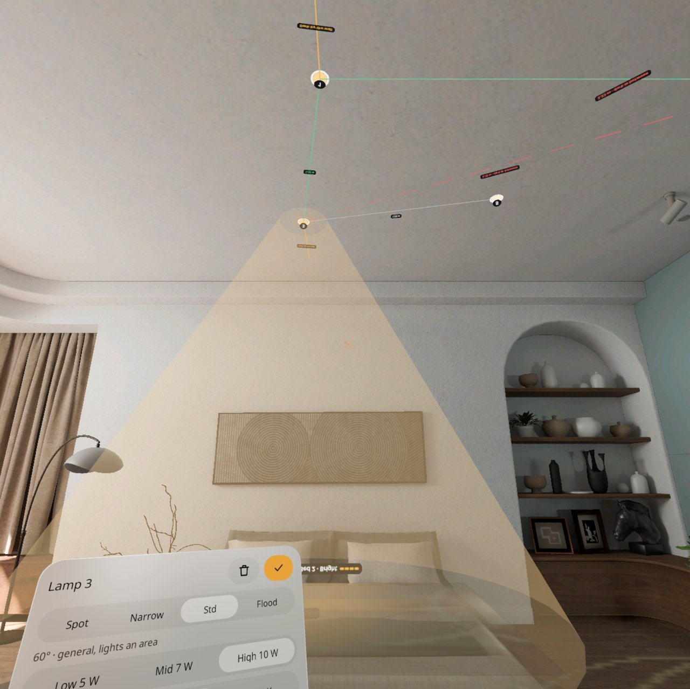
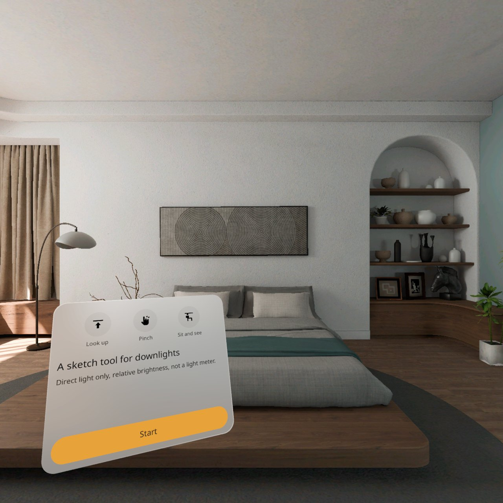
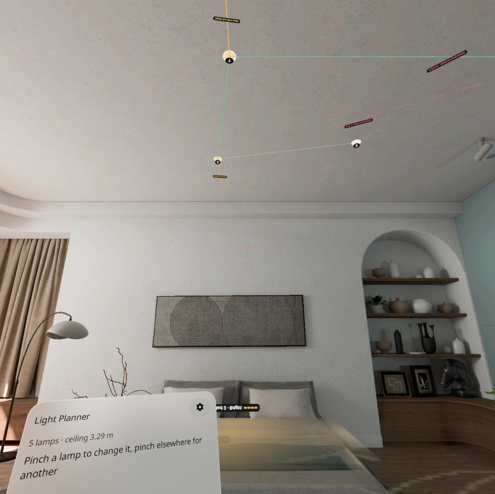
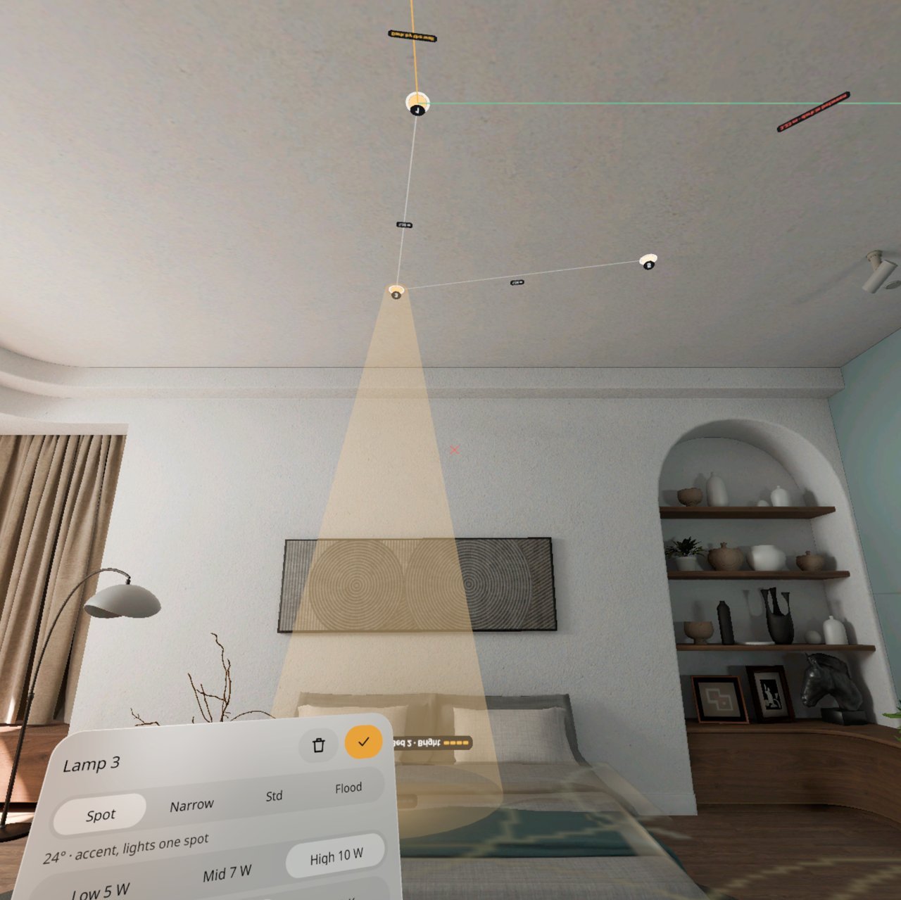
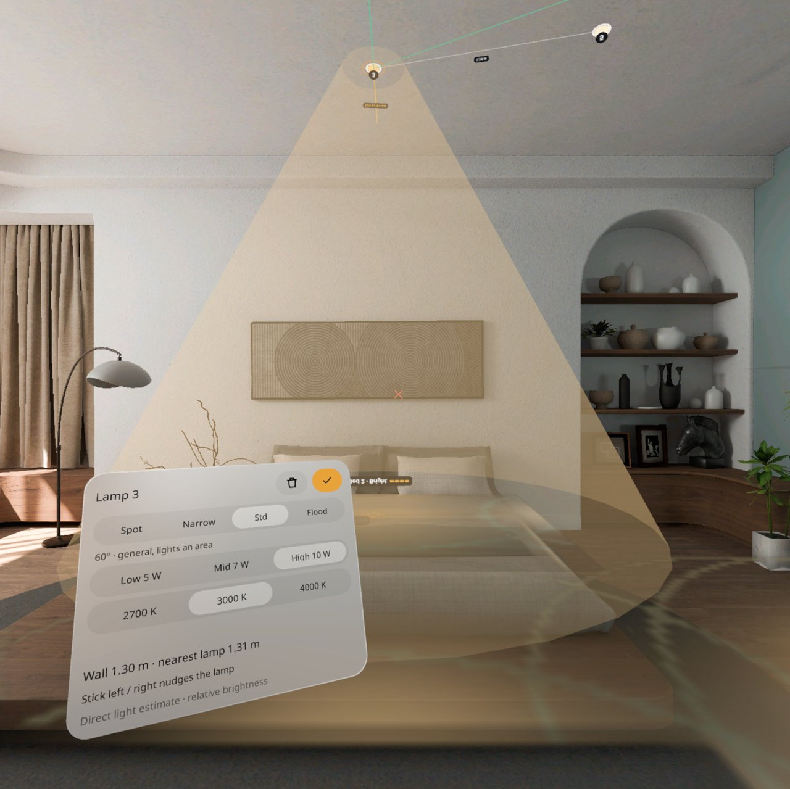
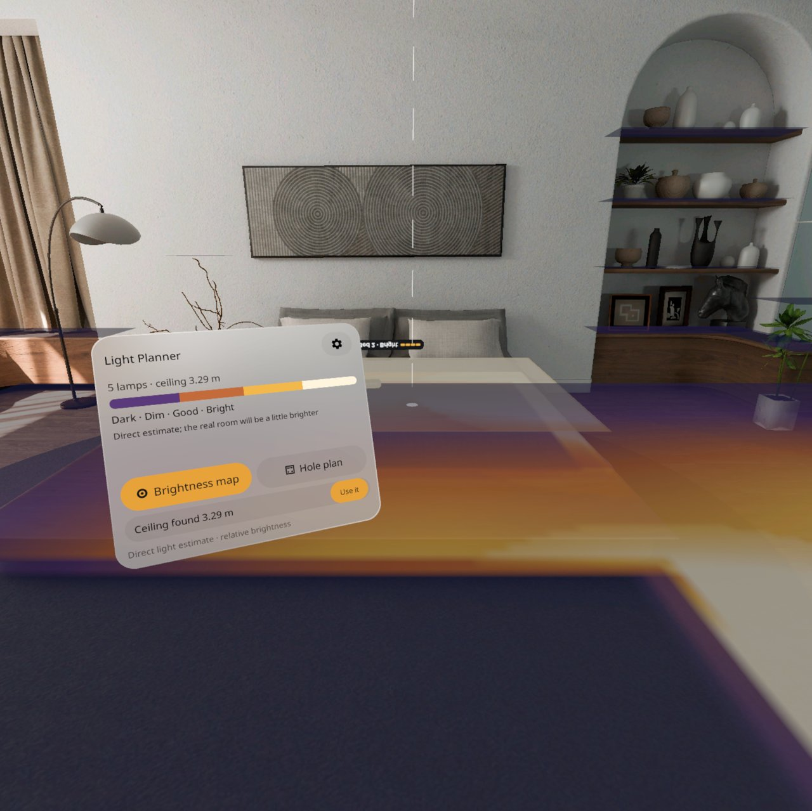
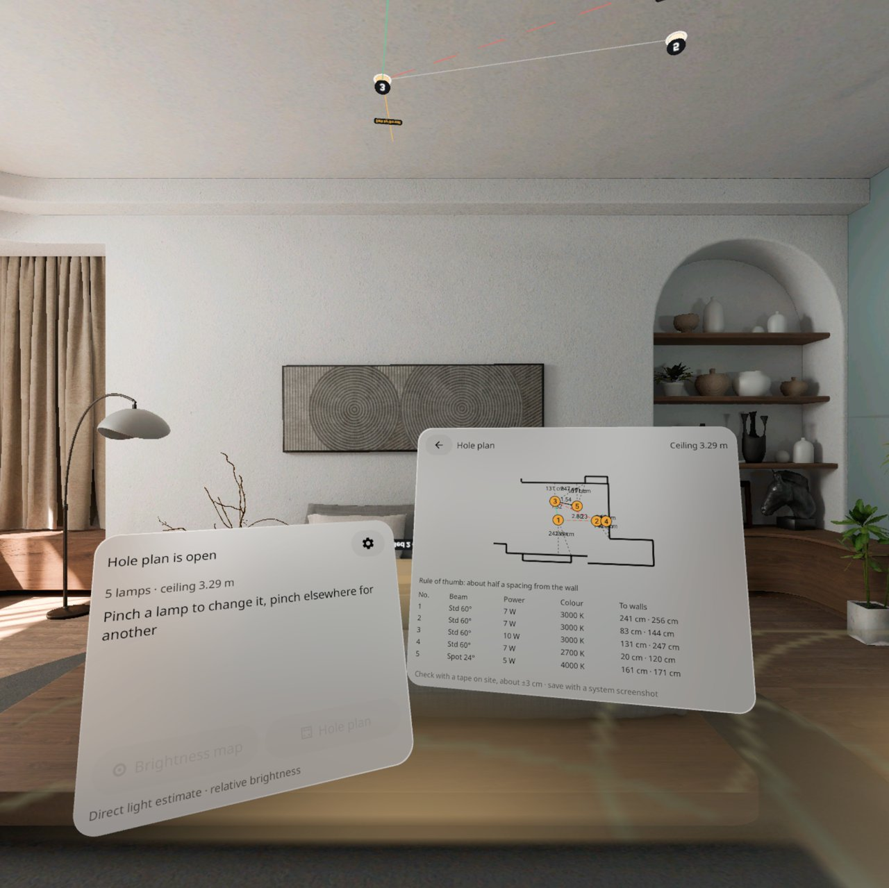
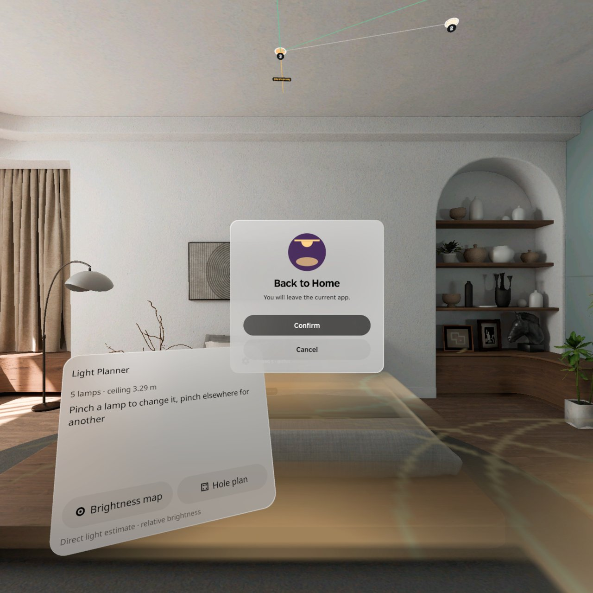

<p align="center"></p>

# Light Planner | 灯光布点

**看向你想照亮的地方捏一下，筒灯就装在正上方的真天花板上，光斑落在你家桌面和沙发上，间距对不对一眼就知道。**

**Look at the spot you want lit and pinch: a downlight lands on the real ceiling right above it, its light pool falls on your real desk and sofa, and you can see at a glance whether the spacing is right.**

PICO OS 6 · PICO Spatial SDK 6.1.9 · Kotlin / SpatialUI · package `io.embodit.lightplanner` · v0.1.0 (pre-release / 预发布)

> **模拟器 QA 通过，真机未验证（Simulator-QA passed; not yet verified on a real headset）。**



> 截图和演示视频来自原生模拟器（PICO Emulator 6.1），由调试广播和模拟器鼠标（= 视线 + 捏合）驱动；模拟器系统语言是英文，所以截图里界面显示英文；**非真实手势录像**。
> Screenshots and the demo video were taken on the native PICO emulator, driven by debug broadcasts and the emulator mouse (standing in for gaze + pinch); the emulator's system language is English, so the UI shows in English; **not a recording of real hand gestures.**

---

## 中文

### 这是什么

装修前布筒灯：看着想照亮的桌面、沙发、床或地面捏一下，一盏筒灯就装到正上方的真天花板上，光斑落在下面的真家具和地面上。灯与灯之间在天花板上画间距线：间距合适是绿线，太远会标红「中间会暗」；离墙太近画一条琥珀短线。每张桌子、茶几、沙发、床上方有一个小标签：暗 / 偏暗 / 合适 / 偏亮 / 不均，坐过去一看就知道。

捏灯选中，可以改光束角（聚光 24° / 窄光 36° / 常用 60° / 泛光 90°）、亮度（约 5 / 7 / 10 W）、色温（2700 / 3000 / 4000 K），捏住拖动挪位置，挪的时候会和别的灯对成一排。打开「亮度图」，地面和家具换成由暗到亮的伪彩；打开「开孔图」，出一张俯视平面图和表格（光束、功率、色温、离墙距离），给电工开孔用。最多 16 盏，方案自动保存、下次打开放回原位。中英双语，全部本机保存，不联网。

只算直射光，显示相对亮度，不是照度计。

### 安装与启动

```bash
adb install -r LightPlanner-v0.1.0.apk
pico-cli app launch io.embodit.lightplanner
```

APK 在 [Releases](https://github.com/kejing-dev/LightPlanner/releases) 页面下载（仓库不含 APK）。需要 PICO OS 6 头显或 PICO Emulator 6.1；用到天花板 / 家具平面识别和空间锚点。APK 约 34 MB。覆盖安装前先 `adb shell am force-stop io.embodit.lightplanner`：在应用运行时直接覆盖安装，模拟器上会留下一个关不掉的「没有响应」框。

### 容器与骨架

- **容器**：只有 Full Space · `STAGE_MIXED`（透视），没有 Shared Space 版本。灯要装在真天花板上、光斑要落在真家具上，依赖天花板 / 家具平面识别和世界锚点，只在 Full Space 可用。
- **骨架 D**（同影院规划 Theater Planner / 空间尺 Spatial Ruler）：面板池、Stage 根实体、平面碰撞体、世界锚点、系统拖动换算、懒跟随、摇杆输入。光照在后台线程按 cosⁿ 光强模型和直射遮挡估算，结果画成动态贴图光层；网格和贴图排队按帧生成。
- **状态**：设计包 18 个状态（S00–S17），全部可由调试广播直接跳转并截图，结构见 [AGENTS.md](AGENTS.md)。

### 截图

| | |
|---|---|
|  |  |
| 说明页 — 抬头 · 捏一下 · 坐过去看 | 布灯 — 5 盏灯，绿线合适、红线中间会暗 |
|  |  |
| 聚光 24° — 光锥变窄，标「重点照明」 | 单灯面板 — 光束 / 亮度 / 色温 / 离墙距离 |
|  |  |
| 亮度图 — 暗 · 偏暗 · 合适 · 偏亮 | 开孔图 — 平面图 + 表，给电工开孔 |

启动器图标：



### 已知问题（QA 第 1 轮，不影响使用）

- 开孔图的平面图上，灯靠得近时距离数字叠在一起看不清；下面表格里同样的数字是清楚的，照表格量即可。
- 选中一盏灯时打开开孔图，偶尔第一帧是空白卡片，几秒后正常画出。
- 仅调试路径：没点过「开始」就用调试指令放的灯，重开后会丢、编号接着往下排；正常使用一定先点「开始」，碰不到。

还没在头显上验过：真手柄摇杆微调的手感、光斑贴在真桌面 / 沙发上准不准、筒灯装在真天花板上的位置、坐过去看的亮度感觉、真实权限流程、退出重开后锚点能不能在真房间找回。

---

## English

### What it is

Plan downlights before renovating: look at the desk, sofa, bed or floor you want lit and pinch, and a downlight is mounted on the real ceiling right above it, with its light pool falling on the real furniture and floor below. Lines between lamps on the ceiling show the spacing: green when fine, red with a warning when the gap would leave a dark patch, plus a short amber line when a lamp is too close to a wall. Every desk, coffee table, sofa and bed gets a small tag (dark / dim / good / bright / uneven) you can read by sitting down.

Pinch a lamp to select it and change the beam (Spot 24° / Narrow 36° / Std 60° / Flood 90°), output (about 5 / 7 / 10 W) and colour temperature (2700 / 3000 / 4000 K); pinch and drag to move it, and it snaps into a row with the other lamps. The brightness map recolours floor and furniture from dark to bright; the hole plan shows a top-down plan and a table (beam, power, colour, distance to walls) for the electrician. Up to 16 lamps; the plan is saved and put back next time. Chinese and English; everything stored on the device, no network.

Direct light only, relative brightness — this is not a light meter.

### Install and launch

```bash
adb install -r LightPlanner-v0.1.0.apk
pico-cli app launch io.embodit.lightplanner
```

Download the APK from the [Releases](https://github.com/kejing-dev/LightPlanner/releases) page (the repository itself does not ship an APK). Needs a PICO OS 6 headset or PICO Emulator 6.1; uses ceiling / furniture plane detection and spatial anchors. The APK is about 34 MB. Run `adb shell am force-stop io.embodit.lightplanner` before reinstalling: replacing the app while it runs leaves a "not responding" dialog on the emulator that cannot be dismissed.

### Container and skeleton

- **Container**: Full Space only, `STAGE_MIXED` (passthrough); no Shared Space version. Lamps mount on the real ceiling and pools land on real furniture, which needs ceiling / furniture plane detection and world anchors — Full Space only.
- **Skeleton D** (same as Theater Planner / Spatial Ruler): panel pool, Stage root, plane colliders, world anchors, system-drag conversion, lazy follow, thumbstick input. Lighting is estimated on a background thread with a cosⁿ intensity model and direct-light occlusion, drawn as a dynamic texture layer; meshes and textures are queued across frames.
- **States**: 18 designed states (S00–S17), each reachable by a debug broadcast and captured; see [AGENTS.md](AGENTS.md).

### Screenshots

See the table above: intro, five-lamp layout, 24° spot, lamp panel, brightness map, hole plan.

### Known issues (QA round 1, none blocking)

- On the hole plan's drawing, distance numbers overlap when lamps are close; the same numbers in the table below are clear.
- Opening the hole plan with a lamp selected occasionally shows a blank card for the first frame; it draws a few seconds later.
- Debug path only: lamps placed by debug command before tapping Start are lost on reopen and numbering continues; normal use always starts with Start.

Not yet verified on a headset: thumbstick fine-tuning with a real controller, how accurately pools sit on a real desk / sofa, lamp position on a real ceiling, how the brightness feels when sitting down, the real permission flow, and restoring anchors in a real room after reopening.

---

## License

Source code © 2026 Embodit. All rights reserved (private repository). Bundled fonts Noto Sans / Noto Sans SC (subset) are under the SIL Open Font License, see `third_party/`.
